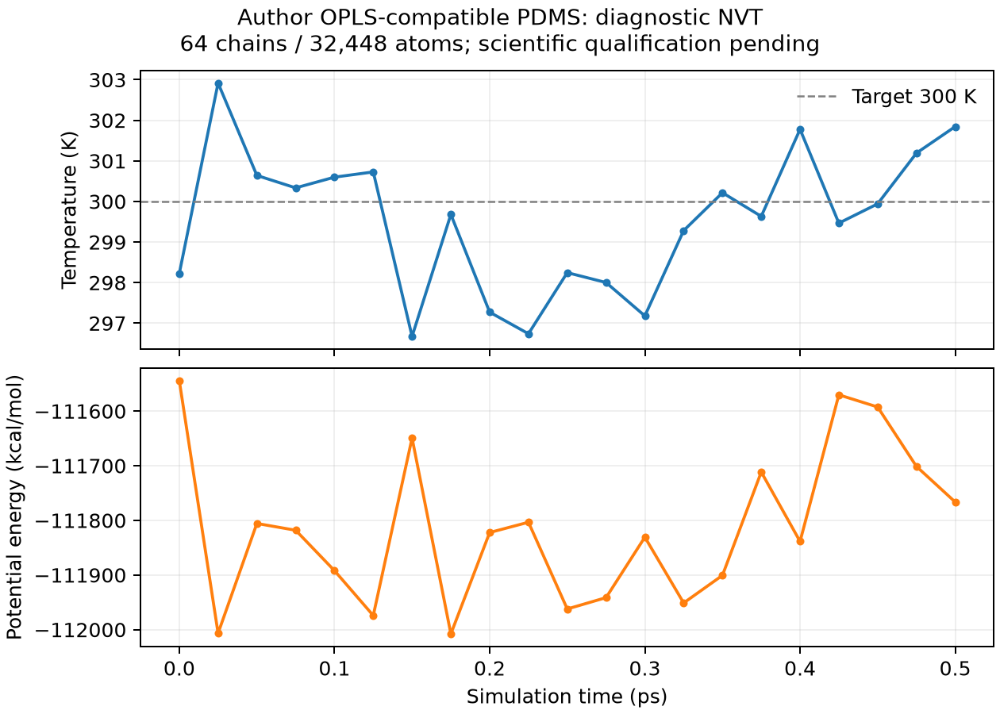

# 作者外部 OPLS-compatible PDMS：本地 MD 诊断

按用户“运行 PDMS 的 MD”的明确请求，已在隔离目录中直接用本地作者输入完成 **300 K、0.5 ps 的 LAMMPS NVT 诊断**。这是作者输入的本地研究复现；科学状态仍为 `scientifically_unqualified`，ISLAND 公共准备入口的既有阻断状态保持不变。

## 实际运行结果

| 项目 | 实测或设置 |
| --- | --- |
| 体系 | 作者原始 64 条链，每链 507 原子，共 32,448 原子 |
| 起始状态 | 原始已热化 data 和速度；未重新打包、生成电荷或最小化 |
| 电荷分支 | 作者仓库 DFT/NPA；论文 DOI `10.1021/acs.jpcb.4c08471` |
| 势函数 | harmonic bond/angle、OPLS proper、CHARMM 切换 LJ、长程 Coulomb |
| 非键设置 | `lj/charmm/coul/long 9 11`，几何混合，LJ/Coulomb 1–4 各 0.5 |
| 实际 MD 长程设置 | 原始 `pppm 0.0001`，默认 5 阶插值与 Coulomb table 12 |
| 系综 | Nose–Hoover NVT，目标 300 K，阻尼 100 fs |
| 步长、步数 | 0.5 fs，1,000 步，共 0.5 ps |
| 初始 / 最终温度 | 298.222885 / 301.845536 K |
| 21 个温度采样的平均值 | 299.552023 K；范围 296.674731–302.918004 K |
| 初始 / 最终势能 | −111544.093925 / −111766.450831 kcal/mol，保留 LAMMPS real 单位 |
| 保存轨迹 | 每 100 步一帧，共 11 帧；全部原子记录有限且身份一致 |
| 原子、电荷 | 无原子丢失；ID、类型、分子归属和 binary64 电荷与原始来源一致 |

盒长约 73.403619 Å，NVT 输入密度约 1.000074 g/cm³。这是固定体积所施加的密度，不能据此宣称预测了平衡密度或获得实验吻合。未运行 NPT。



原始输出保存在：

```text
/inspire/ssd/project/sais-suiren-foundation-model-prediction/public/yh/island-validation/pdms-author-md-20261028/
  md-nvt.in / md-nvt.log / md-nvt.screen
  trajectory.lammpstrj / trajectory.lammpstrj.gz
  checkpoint.500.restart / checkpoint.1000.restart / final.restart
  final-state.lammpstrj
  relocated-resume/
```

## 数值资格与续跑

原始输入的单个 H 力分量差分未达到既有 `1e-4 kJ/(mol·Å)` 严格阈值。另行采用更紧求解设置 `pppm 1e-9`、7 阶插值、`table 0`，对 H/O/Si/C 四个原子的 12 个力分量，在 `1e-4`、`5e-5 Å` 两个位移步长下作了 24 次比较。最大误差为 **0.001157715 kJ/(mol·Å)**，该严格对照也未通过。原因仍需进一步逐项核对，不能据此宣称后端已完成验证。

实际 MD 明确使用作者原始求解设置。较紧对照只用于保留诊断结果，没有被冒充为作者设置或通过的验收结果。中间诊断脚本曾在恢复位移后读取未更新的力；已将全部解析力引用移到任何位移之前，该中间结果不用于物理结论。修正后的完整原文和数据保存在 `inputs/fd-verified.in`、`verified-finite-difference-report.json`。

本次 MD 是用户请求的隔离本地诊断，不产生执行 profile，也没有将被阻断的 ISLAND preparation 改为可执行。**严格差分、实际 PDMS 跨引擎比较和项目级科学验收仍未通过。**

将第 500 步 checkpoint、原始 init 和续跑输入复制到新目录，在新进程中继续至第 1,000 步：

| 比较 | 最大绝对差 |
| --- | --- |
| 展开坐标或最小镜像坐标 | `1.4211e-14 Å` |
| 速度分量 | `7.80e-16 Å/fs` |
| 力分量 | `1.28e-11 kcal/(mol·Å)` |
| checkpoint 字节 | 不相同 |

原始包裹坐标可相差一个盒长，已连同 image flags 展开比较。很小的数值差异不等于逐字节相同，因此精确 checkpoint 续跑门槛保持未通过。采用源速度和确定性 Nose–Hoover，没有调用随机速度生成或随机恒温器，也没有声称完成随机后端 RNG 验收。

## 来源和执行身份

ZIP SHA-256 为 `8b0e8b74303b39b1b0650be3a15b8dd201b20027465f95ffc3f2989da123fea4`，作者提交为 `0053fda8449797e7e2b0790426cfc52dcd023e3e`。原始四份 OPLS 文件在运行前后均按固定 SHA-256 核对，17 条相关系数的独立来源重建沿用并保持原有审计。

本次 MPI 可执行文件是本地 `lammps/lammps/build-mliap/lmp`，版本为 10 Sep 2025 Development / `patch_10Sep2025-244-g36f7c81ced`，采用 8 个 CPU MPI rank、每 rank 1 线程，没有启用 GPU suffix。文件 SHA-256：

```text
lmp:
ca72a7f46e44f61d56ebc532bbc5fa6d275a8c94ff5487bd49b873e60140a1f5
liblammps.so.0:
b69b7612f313d882e4001f5e1a858aee962aee088a505bb2595cf6395652dda3
```

另绑定了 launcher 和 19 个动态依赖，见 `engine-provenance.json`。早先串行初始检查使用已固定的 J22 可执行文件。首次 MPI 启动的 UCC 共享内存分配失败，后以显式通信配置重试；首次压缩 dump 输出因未编译 COMPRESS 插件失败，后改为普通 dump 并在 MD 完成后压缩。两次失败均发生在 MD 积分前，日志保留在运行目录。

原 data 中的旧 `# zero` style 标头产生了 style mismatch 警告；本次保留警告及作者原始的 init → data → settings 顺序，最终使用固定 settings 中的系数。没有为了运行而插入缺失零项或忽略缺失系数错误。

来源许可范围沿用[已有核对](pdms_source_license_model_confirmation.md)，没有因本地运行而新增或推断再分发授权。参数和结构资产保存在本地运行目录；本次未提交或推送。

## 复现

在仓库根目录执行下列离线命令，在尚不存在的新目录中复制已校验的显式来源和本次输入：

```bash
python - <<'PY'
from pathlib import Path
from hashlib import sha256
from zipfile import ZipFile
from shutil import copy2
from scripts.analyze_pdms_author_md import PINS

archive = Path('island_ffref/pcff/PDMS_benchmark-main.zip')
assert sha256(archive.read_bytes()).hexdigest() == '8b0e8b74303b39b1b0650be3a15b8dd201b20027465f95ffc3f2989da123fea4'
destination = Path('/tmp/pdms-author-nvt-new')
with ZipFile(archive) as z:
    files = {n: z.read('PDMS_benchmark-main/param/OPLS/' + n) for n in PINS}
for n, b in files.items():
    assert sha256(b).hexdigest() == PINS[n]
destination.mkdir(exist_ok=False)
for n, b in files.items():
    (destination / n).write_bytes(b)
for n in ('md-nvt.in', 'md-resume.in'):
    copy2(Path('docs/evidence/pdms_author_md_smoke_v1/inputs') / n, destination / n)
PY

cd /tmp/pdms-author-nvt-new
OMP_NUM_THREADS=1 OPENBLAS_NUM_THREADS=1 /usr/local/mpi/bin/mpirun \
  --allow-run-as-root --mca coll '^ucc,hcoll' --mca pml ob1 \
  --mca btl self,vader --bind-to none -np 8 \
  /inspire/ssd/project/sais-suiren-foundation-model-prediction/public/yh/lammps/lammps/build-mliap/lmp \
  -nonbuf -in md-nvt.in -log md-nvt.log -screen md-nvt.screen
```

独立续跑在新目录复制 `checkpoint.500.restart`、`opls_system.in.init`、`md-resume.in`，使用相同的 launcher、rank、环境、引擎和 `-in md-resume.in`。读取第 500 步后执行 500 步，最终步号为 1,000。

分析已有运行并校验所有 11 帧及身份：

```bash
python scripts/analyze_pdms_author_md.py \
  --run ../island-validation/pdms-author-md-20261028 \
  --output /tmp/pdms-md-analysis-new.json \
  --csv /tmp/pdms-md-thermodynamics-new.csv
```

分析程序退出码 0 仅代表已生成运行记录并通过数据完整性检查；JSON 中 `acceptance_gate=1`、`scientific_status="scientifically_unqualified"` 是实际验收结果。

新增分析脚本的 Ruff、compileall、diff check、迁移后新进程分析及来源/输出篡改检查通过。历史 3476 个受保护文件、许可核对 manifest 和 ZIP 审计 manifest 均重新校验通过；本次未重跑完整软件测试套件。来源、运行文件和产物哈希见 [receipt.json](evidence/pdms_author_md_smoke_v1/receipt.json)。

保持 `production_validated=False`、`simulation_readiness="not_established"`。既有 polymer Ewald/PME、backend pressure、cutoff recovery、long-NPT 限制保持原样；没有平衡或实验吻合结论。
