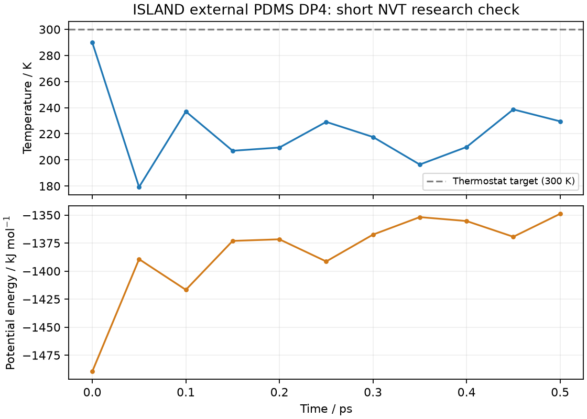

# PDMS 参数分配与短程 MD

现在可以通过 ISLAND 的显式研究接口完成：

```text
PSMILES → 明确封端和补氢 → 最终图校验 → 来源绑定的参数分配
        → LAMMPS 文件导出 → OpenMM 最小化 → 严格差分检查 → 短程 NVT → checkpoint 续跑
```

首个经过检查的范围是 HMDS 和三甲基硅封端的线性 PDMS，包含 DP2、DP4。使用 Xiang et al., *J. Phys. Chem. B* 129 (2025), 1864–1873，DOI `10.1021/acs.jpcb.4c08471` 作者输入中的 **DFT/NPA 分支**。它不是论文主要结果使用的 Qeq 分支，也不是原生 OPLS-AA、PCFF 或 COMPASS。

独立外部 profile 为 `island_external_opls_pdms_xiang2025_dft_local_v1`，请求名称为 `external_pdms_opls`，公共命名空间为 `island.forcefields.research`。旧的 `island.forcefields.extensible`、原生入口、Class-II bundle 和所有既有审计文件均保持原始字节。

## 一条命令运行

在当前仓库根目录执行，输出目录必须尚不存在：

```bash
PYTHONPATH=.:src OPENMM_CPU_THREADS=1 OMP_NUM_THREADS=1 OPENBLAS_NUM_THREADS=1 \
../island-validation/phase4g1-env/bin/python scripts/pdms_md.py \
  --archive island_ffref/pcff/PDMS_benchmark-main.zip \
  --archive-sha256 8b0e8b74303b39b1b0650be3a15b8dd201b20027465f95ffc3f2989da123fea4 \
  --dp 4 --box-angstrom 40 \
  --temperature 300 --timestep-fs 0.5 --steps 1000 --report-interval 100 \
  --output /tmp/island-pdms-dp4
```

其他环境需安装本仓库及 `chemistry`、`evaluation` 可选依赖。实际验证环境为 OpenMM 8.6.1、Reference 平台。`--prepare-only` 只分配参数、保存记录并导出 LAMMPS 文件，不启动数值引擎。HMDS 可以改用 `--smiles 'C[Si](C)(C)O[Si](C)(C)C'`。

这里 DP 指 builder 的 PSMILES 拼接次数。使用上述端基时，末端重复单元封端后成为三甲基硅端部，因此 DP4 的实际组成是 **Si₅O₄C₁₂H₃₆，共 57 原子**，包含 3 个作者定义的中间 M 片段；不能把它误读成 4 个内部 M 片段。40 Å 周期盒中只有一条链。这是短链研究示例，不是指定密度的体相 PDMS，也没有热化、平衡或材料性质结论。更长的链需要显式增大盒子；脚本检查分子跨度与 11 Å 截止的关系。

## Python 公共接口

```python
import numpy as np
from island.builders import build_linear_polymer
from island.core import SimulationBox
from island.forcefields.research import (
    ForceFieldRequest, PDMSOPLSOptions, prepare_forcefield, create_evaluator,
)
from island.pdms import run_pdms_md

system = build_linear_polymer(
    "[*:1]O[Si](C)(C)[*:2]", dp=4,
    head_end_group="[*][Si](C)(C)C", tail_end_group="[*]C",
    add_hydrogens=True, random_seed=2026,
)
system.box = SimulationBox(40, 40, 40)
xyz = np.array([system.coordinates.get(i) for i in system.topology.sites])
system.coordinates.translate(20 - xyz.mean(axis=0))
options = PDMSOPLSOptions(
    archive_path="island_ffref/pcff/PDMS_benchmark-main.zip",
    expected_sha256="8b0e8b74303b39b1b0650be3a15b8dd201b20027465f95ffc3f2989da123fea4",
    e_oxygen_site_ids=(system.metadata["polymer"]["head_site_id"],),
)
prepared = prepare_forcefield(system, ForceFieldRequest("external_pdms_opls", options))
prepared.require_executable(system)  # 失败会抛出带完整诊断的 PDMSOPLSError
print(prepared.payload["mapping"])   # 原子 ID、类型、E/M、电荷和质量
print(prepared.payload["interactions"])  # 每个相互作用绑定的源行 checksum

result = run_pdms_md(system, prepared, "/tmp/island-pdms-python", steps=1000)
# 单点计算也可 create_evaluator(system, prepared).evaluate()；使用完调用 close()。
```

不要求用户提供 CAR/MDF。归属不明确的端氧必须显式指定，不能按最小 ID 猜测。多组件最终图需要按记录的组件顺序分别指定端氧。Si–H、Si–OH、Si–O–C、磷、带电／自由基和非三甲基硅端基不从这个来源外推。

## 实际保存什么

- `preparation.json`：不可变、可重建的最终图、原子顺序、组件／分子身份、完整电荷、质量、全部 17 条来源系数和逐行证据。
- `lammps/system.data`、`coefficients.in`、`system.in`：确定性的完整参数与初始化导出；`system.in` 保留作者 PPPM `1e-4` 设置，未自动运行 LAMMPS MD。
- `system.json`、`openmm-system.xml`、`integrator.xml`：重建图和模型所需记录。
- `finite-difference.json`：最小化后，每个原子、每个分量、两个步长的严格差分结果。
- `trajectory.json`：稳定原子顺序下的坐标／速度，单位 Å、Å/ps。
- `checkpoint.chk`：OpenMM 原生 checkpoint，包含恒温器内部随机状态。
- `result.json`、`manifest.json`：最小化、NVT、数值设置和文件哈希。

源码从显式 ZIP 读取并逐文件核对旧审计的 SHA-256，不联网、不发现其他参数文件、不执行作者脚本。三个零扭转来自作者明确的原始行，缺行不会填零。所有原始电荷字面值均保留，包括作者序列化造成的微小净电荷余差；不归一化或重新分配。

## 续跑

独立保存首次运行生成的 `manifest.json` 的 SHA-256。使用相同版本／平台的新进程续跑，不重新生成速度或随机种子：

```bash
PYTHONPATH=.:src OPENMM_CPU_THREADS=1 OMP_NUM_THREADS=1 OPENBLAS_NUM_THREADS=1 \
../island-validation/phase4g1-env/bin/python scripts/pdms_md.py \
  --archive island_ffref/pcff/PDMS_benchmark-main.zip \
  --archive-sha256 8b0e8b74303b39b1b0650be3a15b8dd201b20027465f95ffc3f2989da123fea4 \
  --resume /tmp/island-pdms-dp4 --manifest-sha256 '<独立保存的 manifest SHA-256>' \
  --steps 1000 --output /tmp/island-pdms-dp4-continued
```

篡改来源、图、参数、profile、模型 XML 或 checkpoint 会在续跑前拒绝。目录搬移不改变来源身份，但调用者仍需显式指定 ZIP 路径和独立哈希。

## 数值结果与限制

本次实际 DP4 从 PSMILES 开始，完成最小化、342 次严格差分以及 1,000 步、0.5 ps 的短程 NVT。最小化后的原子力范数 RMS 为 `0.5751 kJ/(mol·nm)`；差分最大误差 `1.224e-5 kJ/(mol·Å)`，低于既有 `1e-4` 阈值。轨迹保持有限；0.5 ps 末温度约 229.56 K，尚未平衡到目标温度，不能据此报告材料性质。

生成的 [DP4 XYZ 轨迹](evidence/pdms_public_v1/dp4-trajectory.xyz) 包含 11 帧，可直接用于分子可视化。HMDS 和 DP2 也分别通过最小化、162／222 次严格差分及 100 步短程 NVT。一次进程内串行运行一个随机 MD 工作流；批量计算使用独立进程。



OpenMM 使用明确记录的高精度 **Ewald `1e-7`**，保留作者 CHARMM 9–11 Å LJ 切换、几何 sigma/epsilon 混合、1–2／1–3 排除和 LJ/Coulomb 1–4 各 0.5。没有用 OpenMM 默认五次切换函数替换 CHARMM 的 r² 多项式，没有关闭电静力或添加 tail correction。作者原输入为 LAMMPS PPPM `1e-4`；这里不声称采用同一个数值求解器。

HMDS、DP2、DP4 均完成独立原始行重建、直接 Ewald 能量和独立差分力对照。LAMMPS 原始 Coulomb 能量与精确方程存在约 `0.0015–0.0035 kJ/mol` 的差异，超过原有精确能量阈值；原始失败记录保留。独立重建其源代码中的 erfc 多项式及单位常数后，算法比较残差小于 `1e-6 kJ/mol`，没有修正引擎输出、参数或阈值。这是有解释的跨实现差异，**精确方程的 LAMMPS 能量 parity 仍标为 false**。

新的 `local_research` 用途记录来自用户明确要求本地运行所提供 ZIP，不表示作者新增许可。仓库再分发范围仍为 `not_established`，没有将论文 CC-BY 自动扩展到独立 GitHub 资产，也没有随本模块发布这些资产。

`production_validated=False`、`simulation_readiness="not_established"`、`scientifically_unqualified` 保持不变。已有 polymer Ewald/PME 科学闭合、压力、cutoff recovery、长 NPT 门槛不变；本入口没有 NPT、压力或平衡性质计算。原生 PCFF 的 full-source acceptance 不因本外部研究入口改变。

详细回执见 [receipt.json](evidence/pdms_public_v1/receipt.json)。

## 独立复现与验证

独立源行解析、直接 Ewald 和编译的 LAMMPS 比较使用下面的显式文件及哈希，不依赖网络：

```bash
export PYTHONPATH=.:src
PDMS_LAMMPS_SRC=/inspire/ssd/project/sais-suiren-foundation-model-prediction/public/yh/lammps/lammps/src
OPENMM_CPU_THREADS=1 OMP_NUM_THREADS=1 OPENBLAS_NUM_THREADS=1 \
../island-validation/phase4g1-env/bin/python scripts/qualify_pdms_public.py \
  --archive island_ffref/pcff/PDMS_benchmark-main.zip \
  --archive-sha256 8b0e8b74303b39b1b0650be3a15b8dd201b20027465f95ffc3f2989da123fea4 \
  --lammps ../island-validation/phase4j22/lmp-kspace \
  --lammps-sha256 6659313ef24e7a8477008c98d19c9410cd0a04e47cff0a9d91216f1040bf9191 \
  --lammps-pair-source "$PDMS_LAMMPS_SRC/KSPACE/pair_lj_charmm_coul_long.cpp" \
  --lammps-pair-source-sha256 8efd83f9c3569b21598177adbf253c03a62fad0767d2d30147d0fe8f686b42e5 \
  --lammps-ewald-constants "$PDMS_LAMMPS_SRC/ewald_const.h" \
  --lammps-ewald-constants-sha256 3b3abb6ada91a5f39cf507c4c121b0df6a662ed60c4aabfd04b2fe7861abb07c \
  --output /tmp/pdms-independent-check

# 包含三个真实图的全分量差分；缺少显式本地 ZIP 时来源测试会跳过。
ISLAND_PDMS_NUMERICAL=1 OPENMM_CPU_THREADS=1 OMP_NUM_THREADS=1 OPENBLAS_NUM_THREADS=1 \
../island-validation/phase4g1-env/bin/python -m pytest -q tests/test_pdms_public.py

# manifest 的独立哈希见 validation.json；校验不会执行 MD。
../island-validation/phase4g1-env/bin/python scripts/validate_pdms_public.py \
  docs/evidence/pdms_public_v1 --repo . --sha256 '<独立保存的 manifest SHA-256>'
```

独立算法比较的成功码只表示所记录的数学／软件检查完成；`lammps_exact_equation_energy_parity=False`、科学验收非零和全部 readiness 限制仍保留。新回执不取代此前审计的阻止结果。
