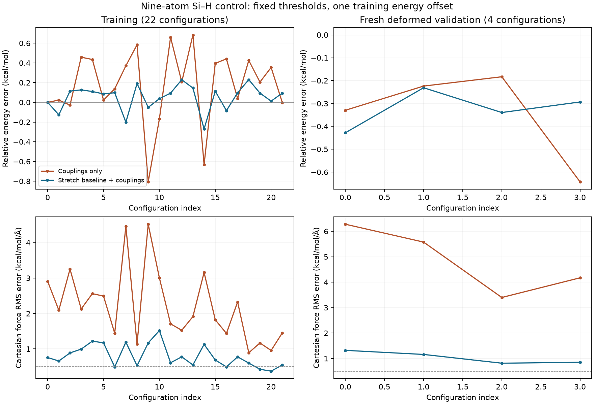
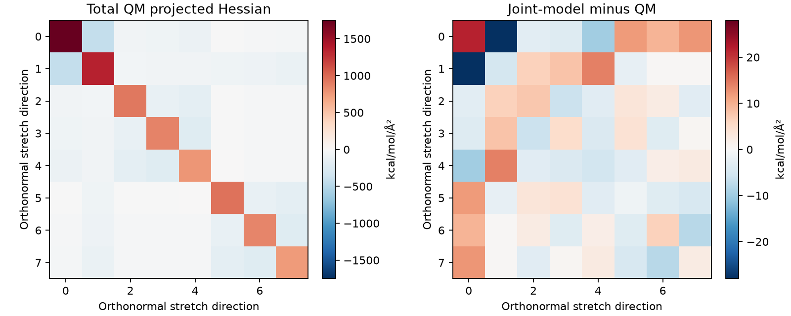

# Phase 4J61 — method-matched stretching baselines and joint Class-II refit

J61 tests whether independently constrained Si–O/Si–H equilibrium and quadratic
stretching baselines explain J60's demonstrated discrepancy. Its exact scope is
the nine-atom neutral-singlet Si–H disiloxane control. No methyl-PDMS transfer,
ordinary PCFF-PDMS assignment, final profile or PCFF MD is established.

## Ancestry and frozen experiment

The fetched main/base is `3f7c1cf37fe1a28a12f4469409b3e2afabff35d8` and contains
J60 `b441b295a0a23d39c67c62237acb292a564e5d99`. Work uses
`codex/phase-4j61-pcff-stationary-baseline-joint-refit`. Historical evidence and
source rows are immutable inputs. No merge or push to main.

J60's retained native data, fit and training-only discrepancy diagnostics were
reconstructed before any J61 QM; see [the replay](evidence/phase_4j61/j60-replay.json).
Their projected fractions overlap and must not be added. They suggest a
stretching mismatch without proving it is the only explanation.

The [scientific plan](evidence/phase_4j61/plan/scientific-plan.json), SHA-256
`80cd44639bf18e5fab5afae20f310c51e751e370582b711075e2b94b9dd59534`, precedes
all new QM. Competing explanations include fixed angular/higher-order/torsional
baseline incompatibility and reference-curvature or identifiability limits.
Fitting weights, bounds and gates were frozen before fresh validation outputs.

The initial cap is **120 new energy/gradient evaluations**. Every optimizer
callback and numerical-Hessian displacement consumes a ledger reservation;
failed or interrupted attempts count too. Allocations are 40 optimization,
32 two-step stretching responses, 15 representative basis/grid/SCF controls,
12 fresh training/validation and validation-basis controls, 4 energy-gradient
checks, and 17 contingency calls. Limits are two concurrent jobs, four threads
and 4 GiB per job, 1,200 seconds per gradient, 20 GiB scratch and 28,800 seconds
campaign wall time. Retained native J60 gradients (median 148.0, maximum 169.8
seconds) informed these limits. No J57 inventory-wide campaign is launched.

## Stationary point and curvature protocol

The primary reference is PBE0/cc-pV(5+d)Z, `def2-universal-jkfit` density fitting,
an unpruned 150 × 974 integration grid, SCF energy/density thresholds
1e−10/1e−8 and integral threshold 1e−12, without dispersion. The pinned basis
inventory has 621 molecular functions and 159 shells. Psi4 1.9.1/Optking uses
redundant internal coordinates and GAU_TIGHT optimization criteria. The old QZ
center is an initial guess only. No engine installation is modified.

Every native optimization step retains its exact ordered geometry, request,
energy, complete analytic gradient, engine settings and hashes. The final
geometry/target have new identities. Ordered atoms remain Si/O/Si/H/H/H/H/H/H;
no symmetry remapping changes the identity. A stationary candidate is not
promoted to a verified molecular minimum.

The stretching subspace consists of the two Si–O and six Si–H bond-length
Cartesian gradients. Six rigid translation/rotation modes about the geometric
centroid are removed with an SVD projector. Positive-diagonal reduced QR
orthonormalizes the remaining rank-eight directions. Coordinates are unweighted
Cartesian, not mass weighted. Displacement amplitudes are in angstrom.

Central gradient differences at **0.004 and 0.002 Å** retain both the full
27 × 8 Cartesian responses and the unsymmetrized/symmetrized 8 × 8 projected
Hessian, in kcal/mol/Ų. Two-step truncation, antisymmetry, energy second
differences, and independent native-text/ASCII reconstruction are checked.
Two additional steps (0.001 and 0.0005 Å) check energy-gradient sign and units.
Representative Si–O/Si–H directions and centers test QZ basis, 99 × 590 grid,
and tighter SCF sensitivity separately. This subset does not establish a full
alternate-protocol Hessian. Positive stretching curvature alone cannot establish
stability in the remaining bending and torsional directions.

Predeclared precision gates are 0.5% two-step relative Frobenius difference,
1% antisymmetry, representative basis/grid/SCF differences of 2%/1%/0.2%,
0.01 kcal/mol/Å energy-gradient agreement and energy-curvature diagonal agreement
within 1% plus 0.1 kcal/mol/Ų. Fresh validation basis controls retain J60's
0.05 kcal/mol relative-energy and 0.5 kcal/mol/Å gradient-RMS gates.

The actual optimization converged in **13 analytic-gradient evaluations** and
1,433.41 seconds. The final energy is −657.6300116272116 hartree; the maximum
and RMS gradient components are 8.2294e−6 and 2.6938e−6 hartree/bohr. Its geometry
identity is `b030e2cd7dfde401999c20ce8344793e8a2c197a928abf6d96775535d4c52b44`.
The two Si–O distances are approximately 1.629994 Å and the six Si–H distances
range from 1.481375 to 1.485275 Å. Optimization lowers the old center's energy by
0.00071105 kcal/mol at this same protocol. Native steps, displacement/energy
criteria and gradients are retained, rather than treating the previous center
as stationary.

All 32 stretching-response gradients completed. The two-step Hessian difference
is **0.007493%**; fine-step antisymmetry is **0.001922%**. The representative
basis/grid/SCF Cartesian-response differences are **0.43297% / 0.014901% /
0.0008628%**. The eight fine-step projected eigenvalues are
370.9604, 523.4871, 1017.9887, 1026.9336, 1038.2991, 1052.4104, 1161.8823 and
2020.3504 kcal/mol/Ų. They establish positive curvature only in this stretching
subspace. No full-molecular minimum claim follows.

Independent native-text/ASCII reconstruction verifies the gradient-to-force
sign and unit conversion. Energy/gradient secants at 0.001/0.0005 Å differ from
the analytic directional gradient by 0.00146034/0.0000141710 kcal/mol/Å; both
meet the frozen absolute criterion. These two errors do **not** demonstrate
clean quadratic convergence. Numerical cancellation and integration/SCF noise
remain relevant near a stationary point. The two-step curvature and separate
protocol controls provide the additional precision evidence.

## Baseline-adjustable research Hamiltonian

The internal identity is
`island_research_class2_sih_disiloxane_j61_stretch_v1`, separate from J60 and
original source rows. It varies only:

- Si–O and Si–H equilibrium distances;
- Si–O and Si–H quadratic stretching coefficients;
- the twenty explicit independent J60 coupling coefficients.

Source cubic/quartic stretch coefficients, angle polynomials/equilibria,
adjacent bond-bond/bond-angle coefficients, charges, LJ/Coulomb conventions,
exclusions and torsional interpretation remain fixed. This is the smallest
extension supported by the existing training diagnostics. No fixed parameter is
changed to improve fresh held-out errors.

Every equilibrium-distance change propagates through quartic bonds, fixed
adjacent bond-bond/bond-angle and fitted first/third bond-bond/end/middle
bond-torsion terms. Energy, Cartesian-force, parameter and mixed derivatives
include these dependencies. Molecular optimized bond lengths are not copied as
MM equilibrium rows. Total projected QM and MM curvature are compared under the
same projection; projected elements are not interpreted as bare bond constants.

The existing Cartesian Jet and source-bound residual infrastructure is reused.
Independent scalar equations, two-step Cartesian finite differences, all 24
parameter/mixed derivatives, rigid projection/covariance, curvature derivatives,
nonzero manufactured recovery and an ill-conditioned repeated-geometry control
test the numerical implementation.

## Training, uncertainty and validation

Training contains the 18 retained J60 training configurations plus four newly
specified deformations. The two inspected J60 held-out conformers are historical
development diagnostics. Four fresh validation configurations are reserved by
deterministic rules before fitting. Their separation from training/history and
from one another is checked under all 72 graph automorphisms and proper rigid
alignment. They are fresh deformed configurations, not independently sampled
conformational basins.

The fit uses relative energies divided by 0.05 kcal/mol and each Cartesian
force component divided by 0.5 kcal/mol/Å. One energy offset is anchored at the
first historical training configuration and reused for every validation geometry.
The stationary force-RMS block uses 0.05 kcal/mol/Å; the projected-curvature
upper-triangle RMS block uses 5 kcal/mol/Ų. Differenced gradients are not also
inserted as independent force observations.

Bounds are source equilibrium distances ±0.08 Å, quadratic coefficients
50–1,000 kcal/mol/Ų, and the original ±1,000 coupling bounds in their declared
natural units. There is no regularization. The actual combined 24-column
Jacobian must have rank 24 and column-scaled condition below 1,000. Active bounds
reject acceptance. The original energy/force acceptance thresholds remain
0.1 kcal/mol RMSE and 0.5 kcal/mol/Å RMS. Added criteria are stationary force RMS
≤0.05 kcal/mol/Å, projected-curvature error ≤5%, and ≥50% training weighted-SS
reduction versus a coupling-only refit with the same constraints.

Uncertainty uses 100 whole-training-configuration bootstrap replicates, seed
4061, with the correlated stationary/curvature block fixed. At least 90 valid
replicates and relative sigma ≤50% for every claimed coefficient are required.
A source-centered restart and coarse-step curvature refit test numerical
sensitivity. Partial basis/grid/SCF parameter responses use only measured entries;
they are not full alternate-protocol refits or uncertainty bounds. Residual
covariance and bootstrap omit source, QM-method/basis and transfer systematics.
Optimizer convergence alone cannot establish scientific acceptance.

## Actual joint-refit result

The four stretch baseline variables and twenty couplings were fitted jointly.
The 679 × 24 weighted energy/force/stationary/curvature Jacobian has rank **24**
and column-L2-scaled condition **6.9730**, with no active bound. The source-centered
restart reaches the same objective and satisfies the frozen parameter-agreement
criterion. These are numerical inference checks, not validation of the model.

| Quantity | Source-baseline coupling-only refit | Baseline-adjustable joint refit |
| --- | ---: | ---: |
| Weighted training/constraint residual SS | 15655.6401 | 2028.1033 |
| Training energy RMSE, kcal/mol | 0.405858 | 0.136648 |
| Training Cartesian force RMS, kcal/mol/Å | 2.415253 | 0.856479 |
| Largest training force-component error, kcal/mol/Å | 13.404481 | 4.086601 |
| Stationary-point MM force RMS, kcal/mol/Å | 0.728401 | 0.542042 |
| Projected-curvature relative error | 12.6007% | 2.06223% |

The joint model removes **87.0455%** of the weighted training/constraint residual
relative to the coupling-only refit under identical constraints. The curvature
criterion passes, but the stationary-force criterion **fails**: 0.5420 exceeds
0.05 kcal/mol/Å. Stretching mismatch explains a substantial part of J60's
discrepancy and does not explain it all. The original J60 fit is also retained
unchanged as a separate comparison; its inspected holdouts remain development
diagnostics.

| Baseline parameter | Unchanged source value | Rejected joint-trial value |
| --- | ---: | ---: |
| Si–O r0, Å | 1.6562 | 1.63972183 |
| Si–H r0, Å | 1.4802 | 1.49047862 |
| Si–O K2, kcal/mol/Ų | 306.1232 | 364.376968 |
| Si–H K2, kcal/mol/Ų | 187.1010 | 200.561637 |

These trial values are fitted research-extension parameters, not replacement
source rows or optimized molecular bond lengths. The complete twenty coupling
values, bounds, Jacobian, correlations and optimization history are retained in
the machine-readable comparison.

On the original 18 training geometries, unchanged J60's energy/force errors of
0.440747 kcal/mol and 2.592741 kcal/mol/Å fall to 0.137446 and 0.917494. This
comparison uses already inspected development data, not fresh validation.

### Fresh validation and uncertainty

All four reserved geometries remain distinct after equivalent-H/end permutations
and rigid alignment. Their nearest seen symmetry-aligned RMS displacements are
0.0691–0.1428 Å. These are distinct deformed configurations, not independently
sampled conformational basins. Every energy uses the same training-anchor offset.

| Fresh configuration | Energy error, kcal/mol | Force RMS error, kcal/mol/Å | Maximum force-component error, kcal/mol/Å |
| --- | ---: | ---: | ---: |
| validation-0 | −0.428000 | 1.319106 | 4.362940 |
| validation-1 | −0.231211 | 1.158305 | 4.012532 |
| validation-2 | −0.339536 | 0.813932 | 2.782850 |
| validation-3 | −0.293320 | 0.849373 | 2.038691 |

Aggregate fresh energy RMSE is **0.330894 kcal/mol**, above 0.1; Cartesian-force
RMS is **1.056602 kcal/mol/Å**, above 0.5. The coupling-only refit gives
0.388937/4.986977; unchanged J60 gives 0.333161/4.851720. The joint model markedly
improves fresh forces, while energy improvement over unchanged J60 is negligible.
The negative energy residuals remain visible; no separate validation offset is
introduced to remove them.

All 100 whole-configuration bootstrap refits completed. Seven couplings exceed
the frozen 50% relative-sigma limit, so the uncertainty gate fails despite the
well-conditioned local Jacobian. The largest empirical bootstrap correlation is
−0.9534 between Si–O r0 and the middle-bond–torsion n=3 coefficient. The largest
off-diagonal residual-covariance proxy correlation is 0.7495 between two
angle–angle coefficients. These are different uncertainty diagnostics and are
not substituted for one another.

Baseline bootstrap standard deviations are 0.0006970/0.0002749 Å for Si–O/Si–H
r0 and 2.7409/1.8459 kcal/mol/Ų for their K2 values. Full parameter samples,
correlations, per-component prediction dispersions and per-configuration
resampling percentiles are retained in `training-bootstrap.json` and
`uncertainty-propagation.json`. They exclude source, QM-method/basis and transfer
systematics and are not calibrated confidence intervals. In particular, good
precision of the four stretch variables does not validate the remaining model.

The coarse-step curvature refit changes r0 by at most 5.97e−8 Å, K2 by at most
0.001222 kcal/mol/Ų and a coupling by at most 0.000317 natural units. The
source-centered restart's largest scaled parameter difference is 6.65e−6,
below the predeclared 1e−5 gate. Fresh QZ/5Z controls differ by at most
0.02194 kcal/mol in relative energy and 0.20824 kcal/mol/Å in gradient RMS.
They pass the frozen reference gates; they do not establish a basis limit or
exclude QM-method systematics. The remaining force discrepancy is larger than
these measured basis changes. Total 27 × 8 Cartesian-response error improves
from 12.69% for unchanged J60 to 2.898% for the joint trial; the projected 8 × 8
comparison alone does not expose all off-stretch responses.





**Decision: 24 trial parameters fitted, zero accepted.** Reference-curvature,
rank/conditioning, bounds, restart, material training improvement and projected
curvature gates pass. Fresh energy, fresh forces, stationarity and bootstrap
uncertainty fail. No numerical gate is widened. No complete profile or MD is
created. The four stretching adjustments are insufficient for this selected
fixed-baseline Hamiltonian; the current data do not uniquely distinguish the
remaining fixed angular/torsional mismatch from restrictions of the selected
functional form.

The [training-only next-experiment plan](evidence/phase_4j61/plan/next-control-experiment.json)
is additive and changes no J61 parameter. At the stationary candidate, **83.6%**
of the joint model's squared force norm lies orthogonal to the stretch subspace.
The largest local unit probe outside the full24 Jacobian is fixed main-torsion
n=3 amplitude, projecting 27.29% of the remaining weighted residual. Angular
equilibrium/stiffness probes also have nonzero projections. These overlapping
fractions must not be added; they do not identify a unique physical cause.

The next control should measure total central/local bending and silyl-torsion
gradient responses at this stationary geometry, with rigid/stretch projection
and two differentiation steps, capped at 16 gradients in a separately frozen
execution plan. That would discriminate fixed torsional/angular baselines before
another model is proposed. J61 does not execute this follow-up, add amplitude or
angular parameters, or request more samples of the same rejected stretching
model by default.

The smallest methyl-specific step is a separately bound **HMDS** target for
`sio(osi,c3,c3,c3)` and methyl `c3(sio,hc,hc,hc)`, with verified typing/unnormalized
source charges and method-matched Si–C/C–H stationary and total-curvature
constraints plus methyl/Si–O torsional reference data. Interior
`sio(osi,osi,c3,c3)` and distinct capped-DP2 end environments require separate
targets. The control touches four directed Si–H queries; fifteen methyl-domain
queries remain separate. None receives J61 trial values.

## Provenance and scope

The 28 interpretation confirmations retain user-attested provenance and
`original_author_artifact_status="not_yet_supplied"`. No author document or
missing numerical source row is invented. Any fitted values are separately
identified `fitted_external` research candidates, never native PCFF rows.

The ordinary API remains `forcefield="pcff"`. Parameter completeness, backend
correctness, optional cross-engine equivalence and scientific validation remain
separate. Exact LAMMPS/OpenMM trajectory replication is not required for this
experiment. No Si–H coefficient transfers automatically to Si–C or methyl-PDMS.

`production_validated=False`; `simulation_readiness="not_established"`.

## Verification and attempt accounting

The executed campaign used **76/120** counted energy/gradient evaluations:
13 optimization, 32 primary stretching responses, 15 sensitivity controls,
four energy-gradient checks and 12 fresh/basis-control calculations. All 76
completed, with no failed or repeated QM call. Their summed native gradient wall
time is 10,939.79 seconds; the maximum single call is 445.51 seconds. Parallel
jobs make this sum different from campaign elapsed time. Scratch/wavefunctions
are not committed.

The supported full-suite coverage is **5,001 unique tests: 4,940 passed and
61 skipped**, including **49 focused J61 tests** and **482 J54–J60 regression
nodes**. This is the effective result **after a documented retry**, not a clean
first-pass claim. One original shard had 20 J34 fixture setup errors: a subprocess
returned 1 with empty captured stdout/stderr, and its temporary diagnostics were
unavailable after pytest cleanup. The exact cause is not established. The
unchanged targeted J34 rerun passed 36 tests; effective accounting uses only its
20 originally errored nodes and preserves every original passing/skipped node.
Original failed XML/log bytes are retained losslessly compressed with original
and compressed hashes. Raw retry records and node-by-node coverage remain
available under `validation/`.

Ruff, J61 formatting, compileall, all five applicable environment pip checks,
diff checks and J54–J60 receipt validators pass. Native replay reconstructs all
76 samples, both projected Hessians, objectives, parameter Jacobian and fresh
errors. A first replay attempt rejected redundant metadata: J60 explicitly binds
`scf_type=df` inside engine settings, while J61 also repeats it at protocol top
level. Reconstruction now normalizes only that explicitly evidenced repetition
and rejects absent or conflicting settings. Its failed attempt, previous source,
successful retry and mutation test are preserved. No reference protocol,
numerical model or fit result changed. Earlier missing-Ruff-module and incremental
import-order attempts are also recorded without describing them as first-pass
successes.

The receipt validator independently recomputes fit gates, checks manifest/native
hashes and exact test coverage, and verifies all **6,064** historical base files
byte-for-byte. The scientific rejection is an expected result, independent of
passing software checks. Historical claims and failures are unchanged.

## Reconstruction, execution and preservation

Native requests, outputs, lossless/ASCII gradients, optimizer history, execution
attempts and the counted ledger are retained in `native-outputs.tar.xz`, with a
recursive SHA-256 inventory. Normalized ISLAND records are separate from those
native bytes. Scratch and wavefunctions stay outside Git. The actual coordinator
and deferred analysis command are retained under `validation/`.

Read-only reconstruction needs the analysis environment, not a Psi4 installation:

```bash
PYTHONPATH=.:src OPENBLAS_NUM_THREADS=1 \
  ../island-validation/phase4g1-env/bin/python \
  scripts/replay_phase_4j61.py replay --repo . \
  --evidence docs/evidence/phase_4j61
```

The original native optimizer invocation uses the pinned Psi4 interpreter,
`PYTHONPATH=.:src`, a dedicated `PSI_SCRATCH`, and
`-m island.pcff_qm_pilot.stationary_engine optimize --work "$J61_WORK"`. It refuses an
existing optimizer output directory. A new reproduction needs a new work and
evidence directory carrying the frozen scientific plan; retained historical
centers and targets must not be overwritten.

The executed preparation, bounded gradient groups and analysis are:

```bash
export PYTHONPATH=.:src OPENBLAS_NUM_THREADS=1 OMP_NUM_THREADS=1
J61_CHECK=../island-validation/phase4g1-env/bin/python
J61_QM=../island-validation/phase4j36-native-env/bin/python
J61_WORK=../island-validation/phase4j61-qm
"$J61_CHECK" scripts/phase_4j61.py prepare --work "$J61_WORK"
"$J61_CHECK" scripts/phase_4j61.py execute --work "$J61_WORK" --python "$J61_QM" --group curvature
"$J61_CHECK" scripts/phase_4j61.py execute --work "$J61_WORK" --python "$J61_QM" --group sensitivity
"$J61_CHECK" scripts/phase_4j61.py execute --work "$J61_WORK" --python "$J61_QM" --group finite-difference
"$J61_CHECK" scripts/phase_4j61.py execute --work "$J61_WORK" --python "$J61_QM" --group fresh
"$J61_CHECK" scripts/phase_4j61.py import --work "$J61_WORK"
"$J61_CHECK" scripts/analyze_phase_4j61.py fit --work "$J61_WORK"
"$J61_CHECK" scripts/replay_phase_4j61.py retain --work "$J61_WORK"
"$J61_CHECK" scripts/finalize_phase_4j61.py --work "$J61_WORK"
"$J61_CHECK" scripts/validate_phase_4j61_receipt.py docs/evidence/phase_4j61 --repo .
```

For a new optimization, first place the unchanged frozen plan at
`$J61_WORK/scientific-plan.json` in a new work directory and provide a new evidence
directory to subsequent commands with `--evidence`. The native module's
`optimize` operation uses that work plan; a dedicated `PSI_SCRATCH` must exist.
The retained evidence is intended for read-only replay, not in-place reexecution.

Repeating an execution group verifies and skips exact completed results. A failed
or interrupted directory is preserved and rejects an in-place retry; any new
attempt requires an additive identity and budget accounting. The archive replay
reconstructs native units, geometry/order, both projected Hessians, the retained
objectives, parameter Jacobian and validation errors without rerunning QM or the
bootstrap. Tests also relocate the evidence into a path with spaces and reconstruct
it in a fresh process.

The manifest binds the complete 6,064-file base Git tree. The initial
`plan/historical-sha256.json` is the narrower 4,920-file `docs/evidence` snapshot;
it is not substituted for the full-tree check. Original historical receipts,
bundles, claims and failures remain unchanged.
